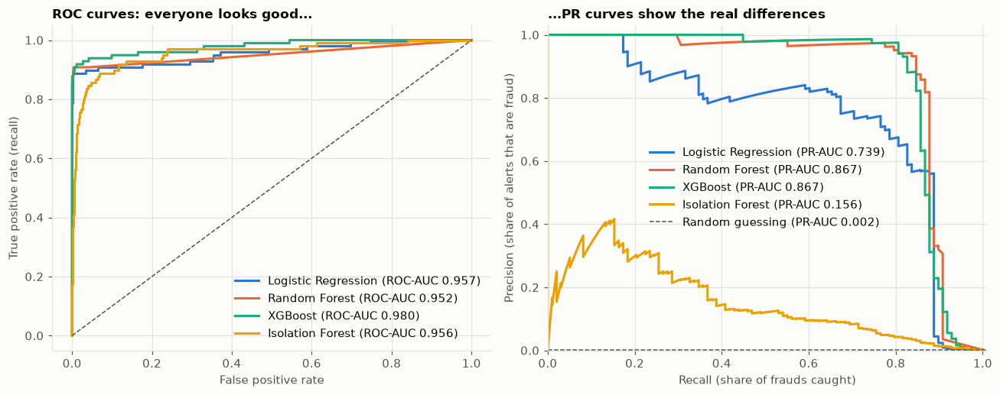
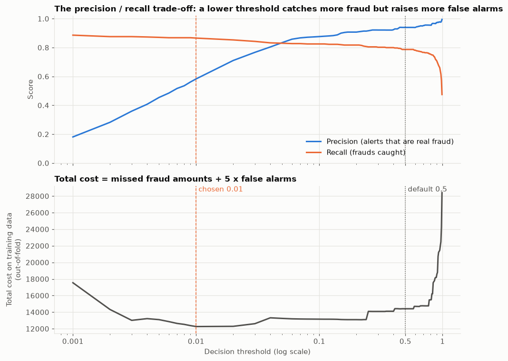
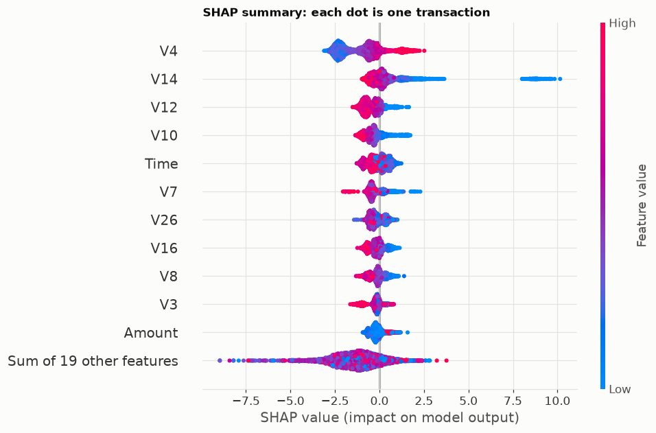
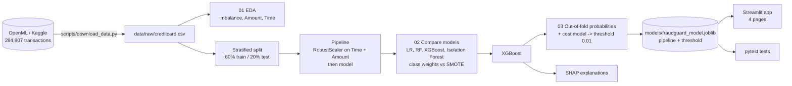
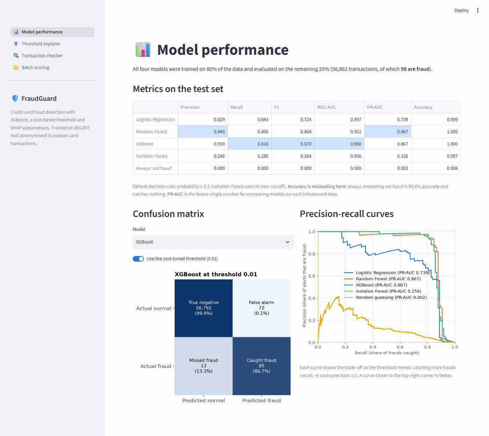
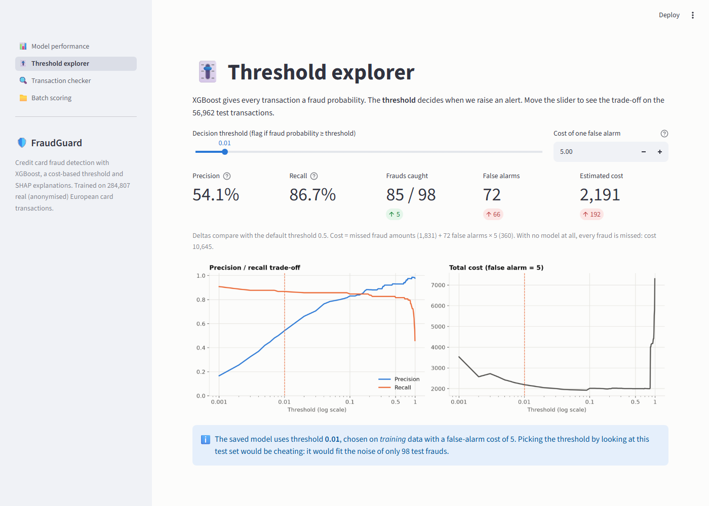
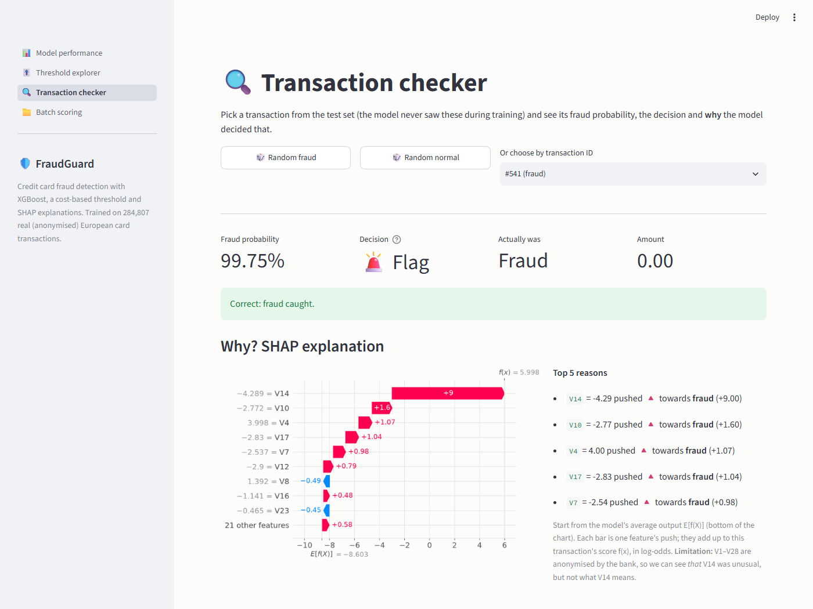
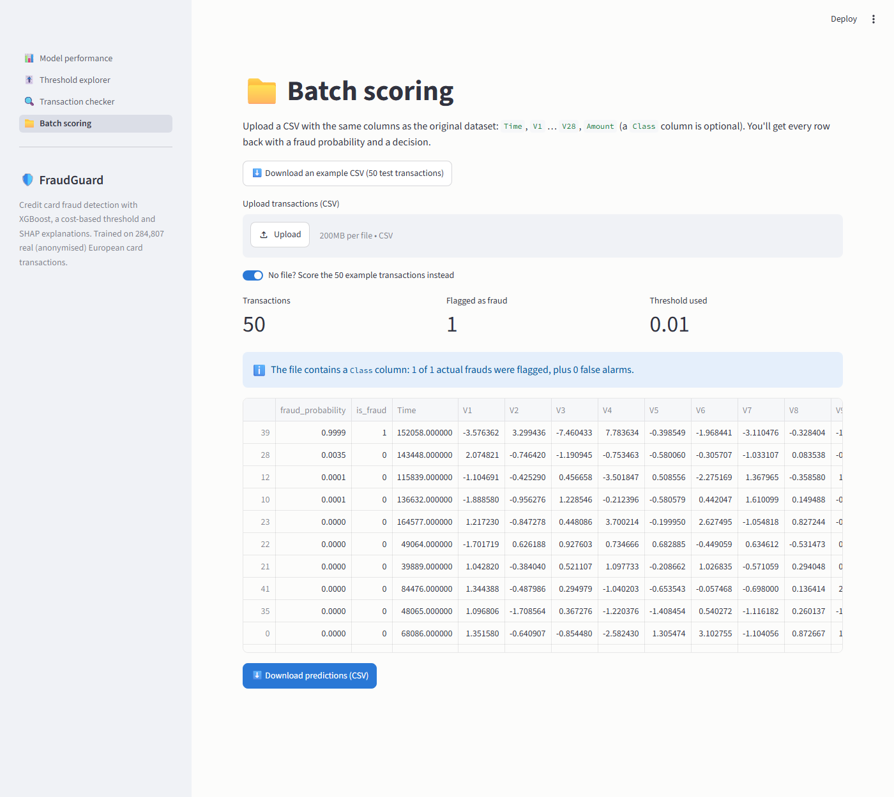

# FraudGuard: Credit Card Fraud Detection

An end-to-end machine learning project that detects fraudulent credit card transactions, chooses its alert
threshold with a **business cost model**, and explains every prediction with **SHAP**.

Built with Python, scikit-learn, imbalanced-learn, XGBoost and SHAP. 100% free tools and public data.

> **Why I built this:** I developed a Credit Card module for a real ERP system, which got me interested in the
> other side of card payments: how banks decide, in milliseconds, whether a transaction is fraud.

---

## Highlights

- **Handles extreme class imbalance** (only 0.17% of transactions are fraud) with the right metrics, not accuracy
- **Compares 4 models**: Logistic Regression, Random Forest, XGBoost and unsupervised Isolation Forest
- **Tests class weights vs SMOTE** with cross-validation, with SMOTE applied **only inside training folds**,
  plus a demo of the data leakage you get when it's done wrong
- **Cost-based threshold tuning**: a missed fraud costs its amount, a false alarm costs a review fee
- **SHAP explainability**: global feature importance and per-transaction explanations
- **Honest evaluation**: threshold chosen on training data only, with a discussion of how noisy the results are
- **Interactive Streamlit app** with live threshold tuning and per-transaction explanations
- **Tested**: 16 pytest tests for preprocessing, the cost model and predictions

## Results

Test set: 56,962 transactions (98 frauds), never used for training or tuning.

| Model | Precision | Recall | F1 | ROC-AUC | PR-AUC |
|---|---|---|---|---|---|
| Logistic Regression (baseline) | 0.829 | 0.643 | 0.724 | 0.957 | 0.739 |
| Random Forest | 0.940 | 0.806 | 0.868 | 0.952 | **0.867** |
| **XGBoost (final model)** | 0.930 | 0.816 | **0.870** | **0.980** | **0.867** |
| Isolation Forest (unsupervised) | 0.246 | 0.286 | 0.264 | 0.956 | 0.156 |
| Always predict "not fraud" | 0.000 | 0.000 | 0.000 | 0.500 | 0.002 |

*Metrics at the default 0.5 threshold. The "always not fraud" row is 99.8% accurate and catches nothing,
which is why accuracy is not used here.*

**Final decision threshold: 0.01**, chosen to minimise total cost on out-of-fold training predictions:

| Threshold | Frauds caught | False alarms | Precision | Recall | Total cost |
|---|---|---|---|---|---|
| No model | 0 / 98 | 0 | n/a | 0.00 | 10,645 |
| Default 0.5 | 80 / 98 | 6 | 0.93 | 0.82 | 1,999 |
| **Chosen 0.01** | **85 / 98** | **72** | **0.54** | **0.87** | **2,191** |

The model cuts the total cost by **~79%** compared with no model. On this particular test set the default threshold happened to cost
slightly less. With only 98 test frauds, the result is dominated by three large frauds that no threshold catches,
and the best threshold varies from 0.003 to 0.44 across cross-validation folds. See
[notebook 03](notebooks/03_threshold_and_explainability.ipynb) for the full discussion.

## Key charts

**ROC curves make every model look good; precision-recall curves show the real differences:**



**Choosing the threshold: precision/recall trade-off and total cost:**



**SHAP: which features drive the fraud predictions:**



More charts (class imbalance, amount and time patterns, confusion matrices, individual SHAP explanations) are in
[`reports/figures/`](reports/figures/) and the notebooks.

## How it works



1. **EDA** ([notebook 01](notebooks/01_eda.ipynb)): fraud is 0.17% of transactions; fraud amounts have a lower
   median (9.25 vs 22, typical of "card testing") and the fraud *rate* rises sharply at night (~10x the average at its peak hour).
2. **Modelling** ([notebook 02](notebooks/02_modeling.ipynb)): stratified split, scaling inside a pipeline,
   class weights vs SMOTE via 5-fold cross-validation, and the four models compared on the test set.
3. **Threshold and explainability** ([notebook 03](notebooks/03_threshold_and_explainability.ipynb)): cost-based
   threshold, SHAP summary and waterfall plots, and saving the model.

### What I learned

- **Accuracy is misleading** with imbalanced data: use precision, recall and PR-AUC.
- **SMOTE before cross-validation leaks data**: it reported recall 1.00 vs a real 0.85.
- **Rebalancing didn't improve ranking quality (PR-AUC)** for any model; it mainly shifts probabilities, which is
  what threshold tuning does explicitly and more transparently.
- **The threshold is a business decision**: a higher false-alarm cost leads to a higher threshold (0.003 at cost 1,
  0.23 at cost 25).

## Streamlit app

An interactive app with four pages. It runs on the saved model and small result files, so it works
**without downloading the dataset**.

| Page | What it does |
|---|---|
| **Model performance** | Metrics for all models, confusion matrix (default or cost-tuned threshold), PR curves |
| **Threshold explorer** | A slider that updates precision, recall, frauds caught, false alarms and estimated cost live, with an adjustable false-alarm cost |
| **Transaction checker** | Pick a random fraud / normal transaction or one by ID: fraud probability, decision and a SHAP explanation of why |
| **Batch scoring** | Upload a CSV (or use the built-in example) and download the predictions as CSV |

### Screenshots

**Model performance**


**Threshold explorer**


**Transaction checker with SHAP explanation**


**Batch scoring**


## Project structure

```
fraud-detection/
├── streamlit_app.py         # app entry point (navigation)
├── app_pages/               # the four app pages + shared loaders
├── fraudguard/              # reusable Python package (used by notebooks, app and tests)
│   ├── config.py            # paths, column names, random seed
│   ├── data.py              # load the dataset
│   ├── preprocessing.py     # stratified split, scaler
│   ├── models.py            # model + pipeline definitions (incl. SMOTE)
│   ├── evaluate.py          # fraud scores and metrics
│   ├── cost.py              # cost model and threshold selection
│   ├── explain.py           # SHAP explanations
│   ├── predict.py           # save / load / predict with the final model
│   └── plotting.py          # shared chart style
├── notebooks/
│   ├── 01_eda.ipynb
│   ├── 02_modeling.ipynb
│   └── 03_threshold_and_explainability.ipynb
├── tests/                   # pytest tests + a 10-row fixture CSV
├── scripts/
│   └── download_data.py     # downloads the dataset (not committed to git)
├── models/                  # final model (114 KB) + small files for the app (~1.5 MB total)
├── reports/
│   ├── figures/             # charts from the notebooks
│   └── screenshots/         # app screenshots
├── requirements.txt
└── pyproject.toml           # pytest settings
```

## Setup and run

Requires **Python 3.12**. Commands are for Windows PowerShell; on macOS/Linux use `source .venv/bin/activate`
and forward slashes.

```powershell
git clone https://github.com/Sara103-125/fraudguard.git
cd fraudguard
python -m venv .venv
.\.venv\Scripts\Activate.ps1
pip install -r requirements.txt
```

**Run the app** (no dataset needed):

```powershell
streamlit run streamlit_app.py      # opens http://localhost:8501
```

**Run the tests** (no dataset needed, ~2 seconds):

```powershell
pytest -v
```

The 16 tests cover preprocessing (stratified split, no train/test overlap, scaling only `Time`/`Amount`
with training statistics), the cost model (a hand-checked example and edge cases) and predictions of the saved
model on real sample transactions.

**Reproduce the analysis** (downloads the data, then run the notebooks in order):

```powershell
python scripts\download_data.py     # ~150 MB, no account needed
jupyter notebook notebooks           # run 01, 02, 03 in order
```

The trained model is already included in `models/`, so you only need the notebooks to reproduce or change the
results (notebook 02 takes ~4 minutes, notebook 03 ~1 minute). Running notebooks 02 and 03 regenerates every file
in `models/`.

**If the OpenML download fails**, get the data from Kaggle instead (a free account is needed):
1. Go to <https://www.kaggle.com/datasets/mlg-ulb/creditcardfraud> and sign in.
2. Click **Download** and unzip the archive.
3. Put `creditcard.csv` in `data/raw/` (so the path is `data/raw/creditcard.csv`).

### Deploying for free (optional)

The app is ready for [Streamlit Community Cloud](https://streamlit.io/cloud): sign in with GitHub, click
**Create app**, choose this repository, branch `main` and main file `streamlit_app.py`. No secrets or dataset
are needed.

## Limitations and ethics

- **False alarms affect real people.** At the chosen threshold about half of all alerts are genuine customers whose
  card gets blocked, possibly while travelling or paying for something urgent. A real system needs a fast, friendly
  way to confirm and unblock, and the review cost should include customer harm, not only analyst time.
- **Bias and fairness can't be checked here.** The features are anonymised, so it's impossible to tell whether the
  model treats groups of customers (by age, region, income...) differently. For example, it could flag people whose
  spending is simply unusual for the majority. A production model would need fairness audits on the original features.
- **Anonymised features limit explanations.** SHAP can say *"V14 was unusually low"*, but not what V14 means, so the
  explanations can't be shown to customers or easily checked by fraud analysts.
- **Small, old, narrow data.** Two days of European transactions from 2013 with only 492 frauds. Fraud patterns
  change constantly, so this model would not transfer to today's payments without retraining.
- **Random rather than time-based split.** A random split lets the model learn from "future" transactions. With more
  data, a time-based split would give a more realistic estimate.
- **Simplified cost model.** Real costs include chargeback fees, customer churn and the cost of reviewing true
  frauds too. The review cost of 5 is an assumption.

## Future improvements

- **Time-based validation** and monitoring for drift as fraud patterns change
- **Amount-aware decisions**: flag when `probability x amount > review cost`, instead of one fixed threshold
- **Hyperparameter tuning** (e.g. Optuna) and a check of probability calibration
- **Customer-level features** (spending history, device, merchant), which matter most in real fraud systems
- **Deploy** the app on Streamlit Community Cloud, and add **CI** with GitHub Actions to run the tests on every push

## Dataset credit

[Credit Card Fraud Detection](https://www.kaggle.com/datasets/mlg-ulb/creditcardfraud) by the
**Machine Learning Group of ULB (Université Libre de Bruxelles)** and Worldline, downloaded from its public mirror on
[OpenML (dataset 1597)](https://www.openml.org/d/1597). Released under the Database Contents License (DbCL) v1.0.

> Andrea Dal Pozzolo, Olivier Caelen, Reid A. Johnson and Gianluca Bontempi. *Calibrating Probability with
> Undersampling for Unbalanced Classification.* IEEE Symposium on Computational Intelligence and Data Mining
> (CIDM), 2015.

The raw data is not included in this repository; `scripts/download_data.py` downloads it.

## Author

Built by [@Sara103-125](https://github.com/Sara103-125)
